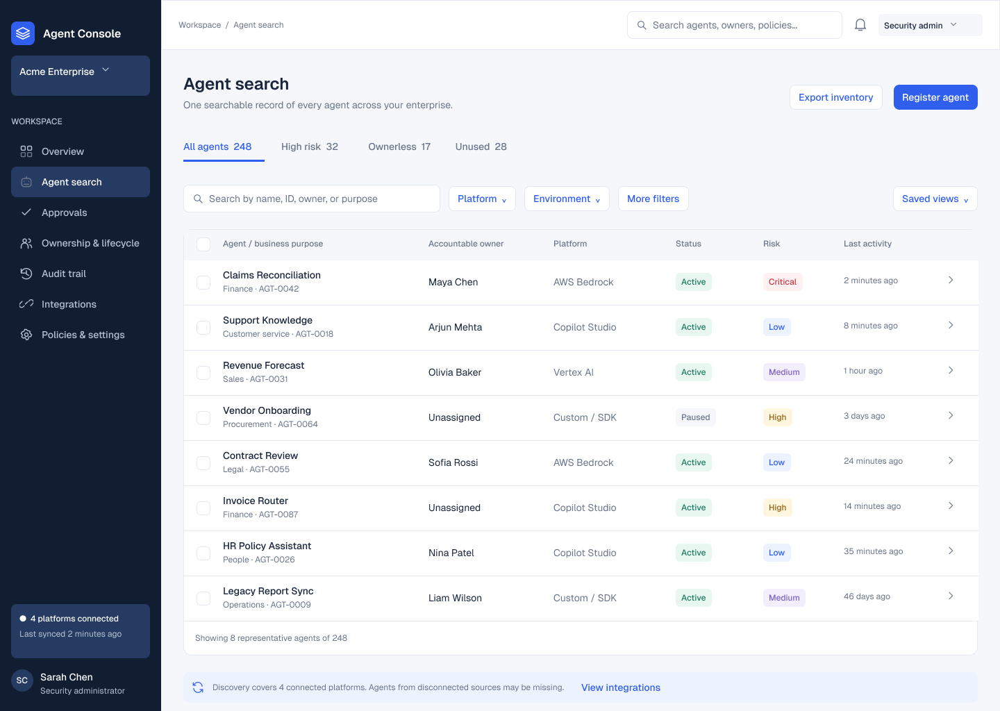
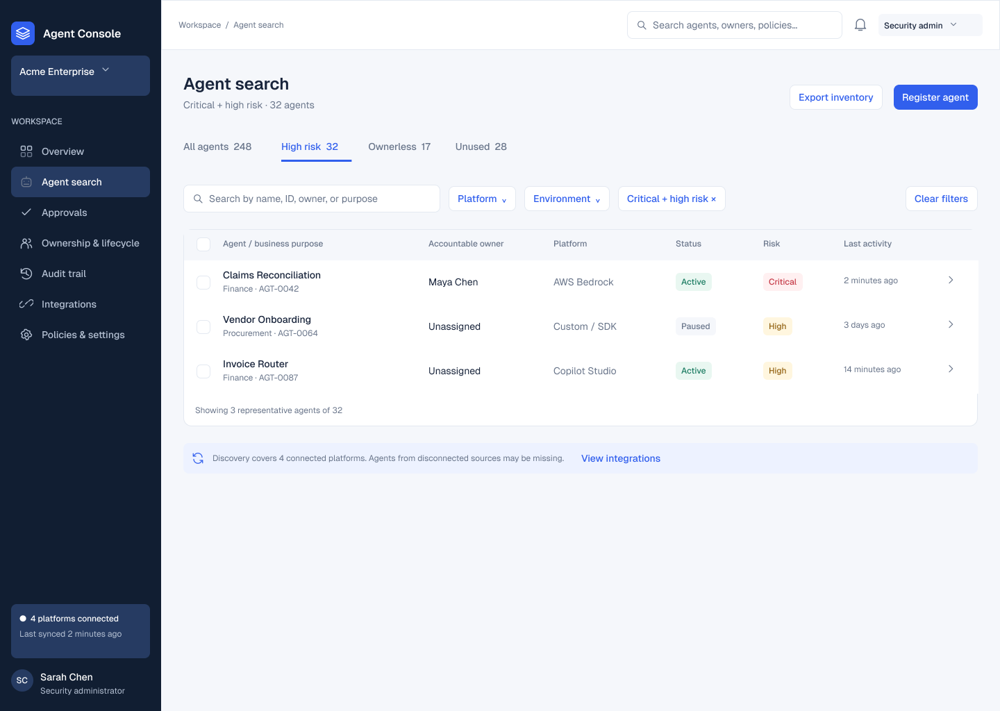
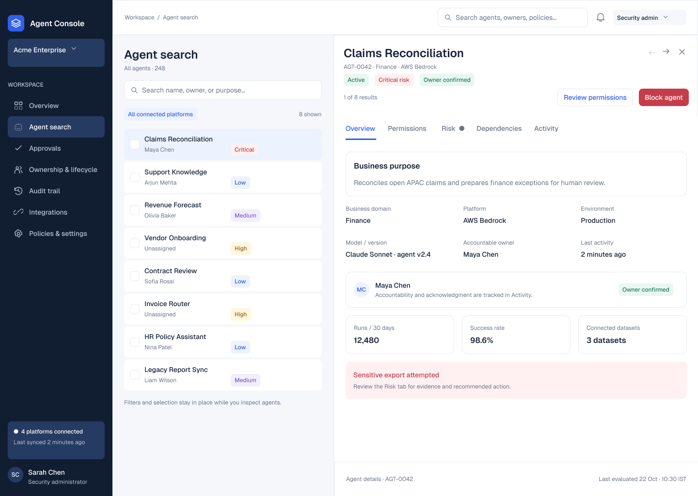
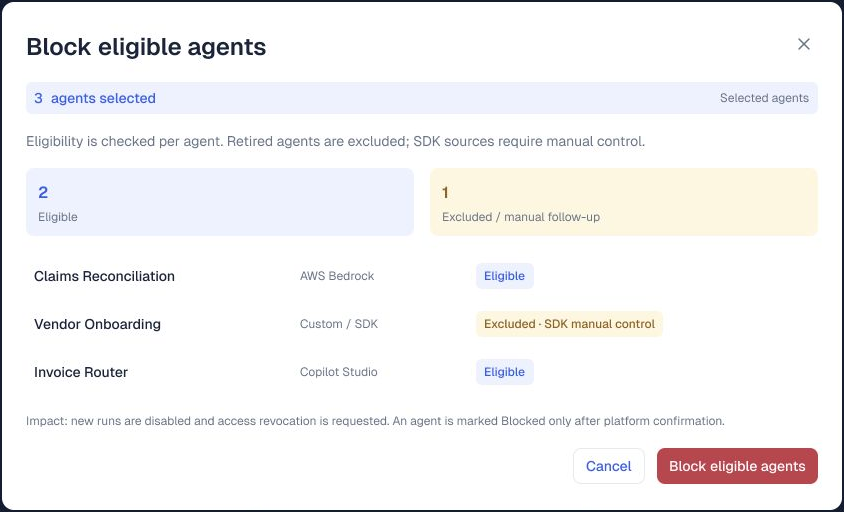
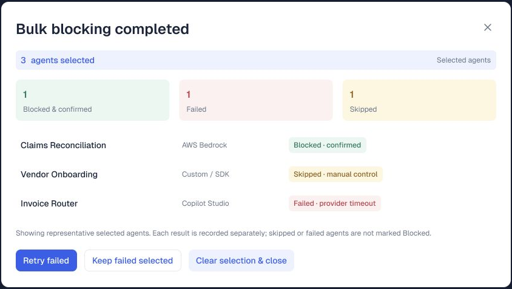

# AI Agent Catalog and Governance Console

**A product management case study on extending enterprise catalog and stewardship principles to AI agents.**

I designed and prototyped a console that helps governance teams discover AI agents, understand their business context and ownership, prioritize risk, and take deliberate governance actions. The central product surface is **Agent Search**: a searchable agent catalog connected to investigation and remediation workflows.

[**Explore the live prototype →**](https://bend-mirror-32622206.figma.site/) · [Figma design](https://www.figma.com/design/LUSAcva35Ic0gjGkxc78Fn/Agent-Management-Console) · [Report with five screenshots](docs/Agent_Management_Console_Report_Section.docx)

| Context | Details |
| --- | --- |
| Project | Independent academic and portfolio case study, originating in an IIM Bangalore class activity |
| My focus | Product framing, agent catalog UX, stewardship, governance workflows, and failure-state design |
| Deliverables | Interactive Figma prototype, documented product decisions, five annotated screenshots, and a static demo showcase |
| Status | High-fidelity prototype using sample enterprise data; no production deployment or measured business outcomes claimed |
| Tools | Figma, AI-assisted prototyping, HTML, CSS, and JavaScript |



## Product problem

As AI agents spread across business units and platforms, a list of agent names is insufficient for governance. An operator needs to answer:

- What does this agent do, and which business purpose justifies its use?
- Who is accountable for it, and has ownership been acknowledged?
- Where does it run, what can it access, and what needs review?
- Which agents are high risk, ownerless, or no longer used?
- If a control is requested, did the source platform actually confirm it?

The product hypothesis is that **a catalog becomes more useful when discovery, accountability, and action outcomes are connected in one operator workflow**.

## Users and jobs to be done

These personas are design hypotheses to validate, rather than findings from completed customer interviews.

| User | Job to be done | Product response |
| --- | --- | --- |
| AI governance lead or data steward | Establish an inventory and identify accountability gaps | Common agent metadata, owner visibility, ownerless and unused views |
| Security or platform administrator | Investigate exposure and apply an appropriate control | Risk filtering, permissions context, eligibility checks, confirmation, and per-agent results |
| Business owner | Understand responsibility and resolve review requests | Business purpose, accountable owner, ownership acknowledgement, and lifecycle views |

## From data catalog concepts to agent governance

| Governance concept | Evidence in this prototype | Product management reasoning |
| --- | --- | --- |
| Asset discovery and cataloging | Agent Search across representative Copilot, Bedrock, Vertex, and custom sources | Normalize the operator experience while retaining the source platform |
| Business metadata | Purpose, business domain, environment, model/version, and activity | Help users assess an agent through business and operational context |
| Stewardship and accountability | Accountable owner, ownership confirmation, and ownerless view | Separate a populated owner field from acknowledged responsibility |
| Classification and triage | Critical/high-risk filtering and risk context | Turn catalog metadata into a focused review workflow |
| Relationships and governed context | Permissions, Risk, Dependencies, and Activity tabs in the agent profile | Keep investigation close to the catalog; deeper data lineage remains a future extension |
| Lifecycle governance | Registration, review, ownership assignment, and retirement flows | Make the asset lifecycle visible to administrators |
| Control assurance | Eligibility preview, platform-confirmed results, failed/skipped states, and retry | Avoid presenting a requested action as a completed governance control |

The platform names in the screens represent sample inventory sources. The prototype does not implement their connectors.

## Walkthrough and design evidence

### 1. Discover agents through a common inventory

Agent Search combines business purpose, ownership, platform, status, risk, and activity. Search and filters support targeted investigation, while High risk, Ownerless, and Unused views expose common governance queues. The inventory screenshot above is the starting point.

**PM strength demonstrated:** translating a metadata model into an information architecture that supports an operator's next decision.

### 2. Prioritize the governance queue

The High risk view surfaces representative critical and high-risk agents, while keeping the search and filter context visible.



**PM strength demonstrated:** designing for exception management and prioritization rather than treating every catalog record as equally urgent.

### 3. Investigate without losing catalog context

Opening Claims Reconciliation retains a compact inventory beside a persistent details panel. The profile brings together business purpose, accountable ownership, operating context, and routes to permissions, risk, dependencies, and activity.



**PM strength demonstrated:** connecting metadata discovery, stewardship, and investigation within one continuous workflow.

### 4. Check eligibility before a bulk action

In the example, three agents are selected. Two support automatic blocking, while the custom/SDK agent requires manual control. The preview explains the scope and expected impact before the user confirms.



**PM strength demonstrated:** accounting for heterogeneous platform capabilities, human approval, and action eligibility in the interaction design.

### 5. Report the actual outcome and support recovery

The simulated result distinguishes one confirmed block, one provider timeout, and one skipped agent. Failed agents can remain selected or be retried. A partial outcome is not reported as universal success.



**PM strength demonstrated:** designing trustworthy completion semantics and operational recovery paths for enterprise workflows.

## Product decisions and tradeoffs

- **Start with an operator workflow.** The core journey is find → assess → establish accountability → act → verify. Agent creation and orchestration are outside this prototype's focus.
- **Preserve business context.** A technical identifier is paired with purpose, ownership, and operating metadata so an operator can judge relevance and responsibility.
- **Keep the inventory visible during investigation.** A persistent profile supports comparing agents and moving through a review queue.
- **Respect source capability differences.** A uniform interface must still disclose when an action needs manual follow-up.
- **Require evidence of completion.** The interface distinguishes requested work from a source-confirmed control and exposes partial failures.
- **Use bulk actions carefully.** Previews, eligibility, explicit confirmation, and per-agent results address the larger impact of changing many assets at once.

## Scope and next validation

| Demonstrated in the prototype | Proposed for a production product |
| --- | --- |
| Catalog search, filters, metadata, and agent profiles | Connector ingestion, identity reconciliation, duplicate resolution, and freshness monitoring |
| Ownership, risk, review, and lifecycle journeys | Permission enforcement, approval engines, and reliable control APIs |
| Eligibility, partial outcomes, and retry interactions | Asynchronous jobs, idempotency, reconciliation, and immutable event records |
| Sample dependency and risk context | Agent-to-tool-to-dataset lineage, glossary/policy links, and propagated data-quality signals |

**Validation plan:** test whether governance operators can find a critical agent, identify its accountable owner, inspect relevant context, and interpret a mixed bulk-action result. Observe task completion, errors, and decision confidence before expanding scope. Customer interviews and usability results are not yet available.

**Proposed success measures — not measured outcomes:**

- Catalog coverage and metadata completeness against a known agent population.
- Ownership acknowledgement coverage, not just owner-field completeness.
- Time to find and assess an agent requiring review.
- Percentage of eligible control requests reconciled to a confirmed source outcome.
- Unresolved partial failures, time to recovery, and manual follow-up backlog.
- Completeness of the evidence associated with a governance decision.

## Repository contents

```text
index.html                      Static showcase and embedded prototype
assets/app.js                   Flow shortcuts and fullscreen behavior
assets/styles.css               Responsive showcase styling
assets/favicon.svg              Showcase icon
assets/screenshots/             Five screenshots used in this case study
docs/PRODUCT_BRIEF.md            Scope, metadata model, prioritization, and validation
docs/Agent_Management_Console_Report_Section.docx
```

**Code boundary:** this repository contains the complete source of the static showcase. The console itself is an interactive Figma prototype, not an exported application codebase. It has no live agent integrations, backend, authentication service, or runtime policy-enforcement engine.

### Run the showcase locally

Open `index.html` in a browser, or serve the folder with any static web server:

```bash
python3 -m http.server 8000
```

Then open `http://localhost:8000`. An internet connection and access to the public Figma prototype are required for the embedded demo. The screenshots remain available locally. No build step, API keys, or package installation is required.

### Maintain the demo

Update the file key and flow node IDs in `assets/app.js` when replacing the prototype. Also update the initial iframe and external link in `index.html`, the live prototype links, and the five screenshots. The static files can be hosted by GitHub Pages or another static host.

---

**Author:** [Saurabh Thakre](https://github.com/SaurabhThakre). All inventory counts, people, agents, and operational outcomes shown in the demo are illustrative sample data.
